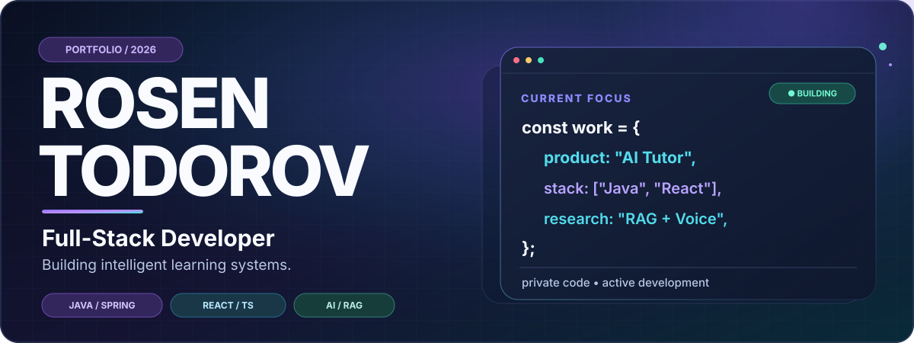
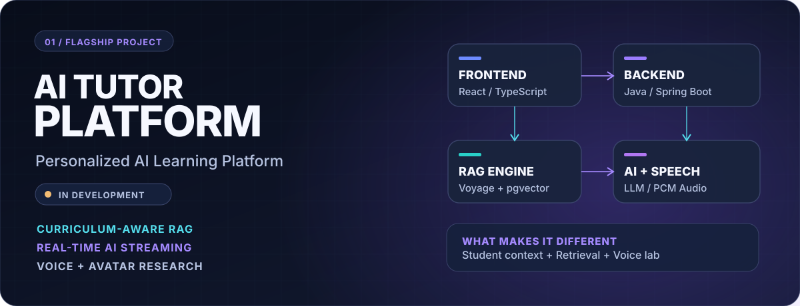
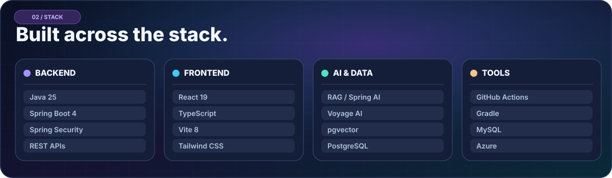
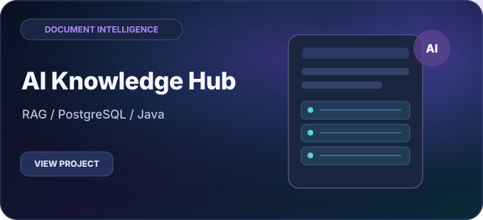
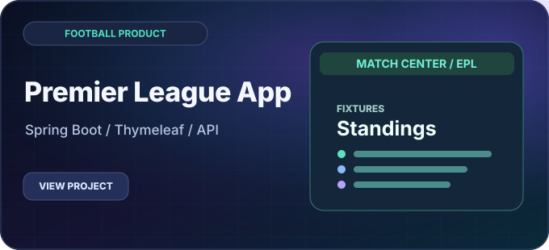
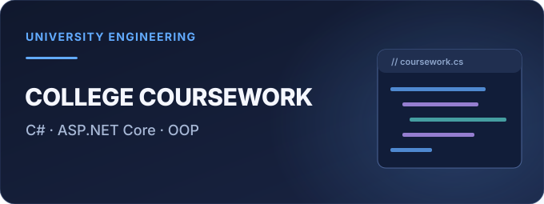
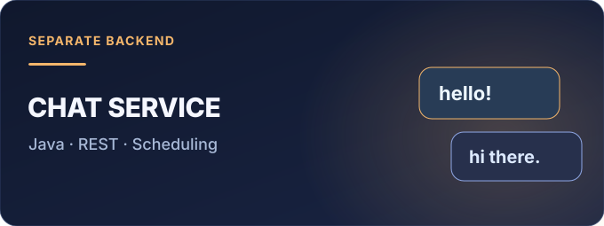

<picture>
  <source media="(prefers-color-scheme: dark) and (max-width: 640px)" srcset="./assets/hero-mobile-dark.svg" />
  <source media="(prefers-color-scheme: light) and (max-width: 640px)" srcset="./assets/hero-mobile-light.svg" />
  <source media="(prefers-color-scheme: dark)" srcset="./assets/hero-dark.svg" />
  <source media="(prefers-color-scheme: light)" srcset="./assets/hero-light.svg" />
  
</picture>

 

<strong>Java &amp; Spring Boot · Full-Stack Engineering · AI / RAG</strong>

Software engineering student at <strong>Technical University of Sofia</strong> · <strong>SoftUni Java Development Path — completed</strong>

 

 

## 01 / Flagship project — AI Tutor

<picture>
  <source media="(prefers-color-scheme: dark) and (max-width: 640px)" srcset="./assets/flagship-mobile-dark.svg" />
  <source media="(prefers-color-scheme: light) and (max-width: 640px)" srcset="./assets/flagship-mobile-light.svg" />
  <source media="(prefers-color-scheme: dark)" srcset="./assets/flagship-dark.svg" />
  <source media="(prefers-color-scheme: light)" srcset="./assets/flagship-light.svg" />
  
</picture>

> **In active development · Source code private** · A personalized AI learning platform for school students, built as a separate **React/TypeScript frontend** and **Java/Spring Boot backend**.

The goal is to make studying more engaging through adaptive tutoring, curriculum-aware retrieval and conversational AI.

<table>
<tr>
<td width="33%" valign="top">

<strong>🧠 Context-aware RAG</strong>

Textbook retrieval using <strong>Voyage AI</strong>, <strong>PostgreSQL</strong> and <strong>pgvector</strong>, with relevant context passed into AI conversations.

</td>
<td width="33%" valign="top">

<strong>🎓 Personalized learning</strong>

Student onboarding, grade/subject catalogs, tutor preferences, authentication and conversation history.

</td>
<td width="33%" valign="top">

<strong>🎙️ Voice &amp; avatar lab</strong>

Experimental WebSocket text/audio streaming, <strong>Kokoro TTS</strong> integration and virtual tutor prototypes.

</td>
</tr>
</table>

**Core stack:** `Java 25` · `Spring Boot 4` · `React` · `TypeScript` · `PostgreSQL` · `pgvector` · `Spring AI` · `WebSocket`

**Project status:** The API, learning workflows and experimental voice infrastructure are under active integration. The voice/avatar workspace is **development-only**; a complete production-ready voice tutoring experience is **not yet released**. Both source repositories are currently **private** while development continues.

---

### 👋 A little about me

I'm **Rosen Todorov**, a developer from **Stara Zagora, Bulgaria**. I enjoy turning ideas into useful products — from **Spring Boot platforms** and **React applications** to **RAG pipelines**, vector search, and experimental real-time AI experiences.

I study at **Technical University of Sofia** and have **completed SoftUni's Java development learning path**, including Java fundamentals, Advanced, OOP, databases and Java Web. My current focus is combining strong backend engineering with AI systems that can help people learn.

---

## 02 / Engineering stack

<picture>
  <source media="(prefers-color-scheme: dark) and (max-width: 640px)" srcset="./assets/stack-mobile-dark.svg" />
  <source media="(prefers-color-scheme: light) and (max-width: 640px)" srcset="./assets/stack-mobile-light.svg" />
  <source media="(prefers-color-scheme: dark)" srcset="./assets/stack-dark.svg" />
  <source media="(prefers-color-scheme: light)" srcset="./assets/stack-light.svg" />
  
</picture>

Alongside my primary stack, I have worked with **C#, ASP.NET Core, MySQL, Python, C, SQL and Spring Security**. I focus on building end-to-end systems rather than isolated demos.

---

## 03 / Selected projects

<table>
<tr>
<td width="50%" valign="top">

<strong><a href="https://github.com/RosenTodorov2006/AI-Knowledge-Hub">AI Knowledge Hub — Document RAG</a></strong>

A separate public document Q&amp;A project using Spring Boot, PostgreSQL and semantic vector retrieval.

</td>
<td width="50%" valign="top">

<strong><a href="https://github.com/RosenTodorov2006/PremierLeagueScoresApp">PremierLeagueScoresApp</a></strong>

Football scores, standings, club pages, user accounts, fan community and an AI assistant — built with Spring Boot.

</td>
</tr>
<tr>
<td width="50%" valign="top">

<strong><a href="https://github.com/RosenTodorov2006/CollegeCourseWork">CollegeCourseWork</a></strong>

<strong>Technical University of Sofia</strong> coursework: an ASP.NET Core MVC football application showcasing OOP, API integration and a match diary.

</td>
<td width="50%" valign="top">

<strong><a href="https://github.com/RosenTodorov2006/PremierLeagueScoresApp-Chat">PremierLeagueScoresApp-Chat</a></strong>

A separately deployable Java REST chat service with MySQL persistence, background cleanup and message moderation.

</td>
</tr>
</table>

**More experiments:** [Djs-Site](https://github.com/RosenTodorov2006/Djs-Site) · [PathFinderApp](https://github.com/RosenTodorov2006/PathFinderApp) · document-ingestion and vector-search research (private)

---

## 04 / Education & growth

<table>
<tr>
<td width="50%" valign="top">

<strong>🎓 Technical University of Sofia</strong>

<strong>University student</strong> · Informatics / software engineering studies

Academic projects, programming fundamentals, software design and practical applications.

</td>
<td width="50%" valign="top">

<strong>☕ SoftUni — Java path</strong>

<strong>Completed Java development training</strong>

Java Basics · Fundamentals · Advanced · OOP · DB · Web

</td>
</tr>
</table>

---

<h3>Let's build useful, intelligent software.</h3>

I'm interested in <strong>backend engineering, AI applications, thoughtful product design and continuous learning</strong>.

<a href="https://www.linkedin.com/in/rosen-todorov-230805264/">LinkedIn</a> · <a href="https://github.com/RosenTodorov2006?tab=repositories">Explore my repositories</a>

Designed for this GitHub profile · 2026 · Custom, self-hosted SVG assets

